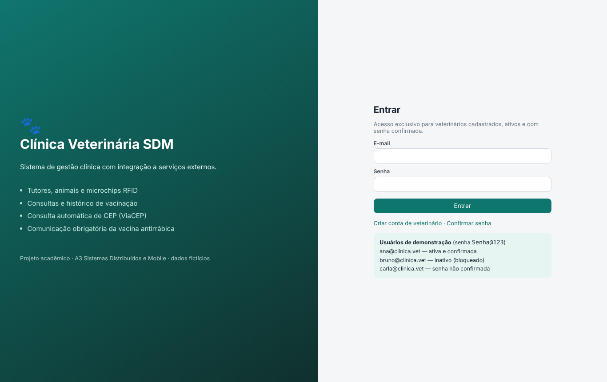
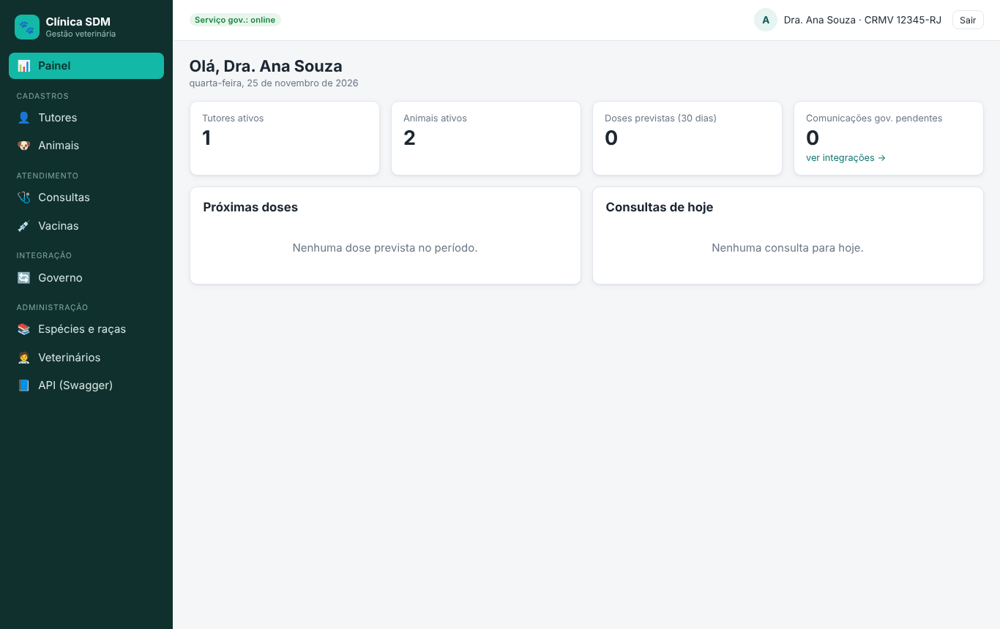
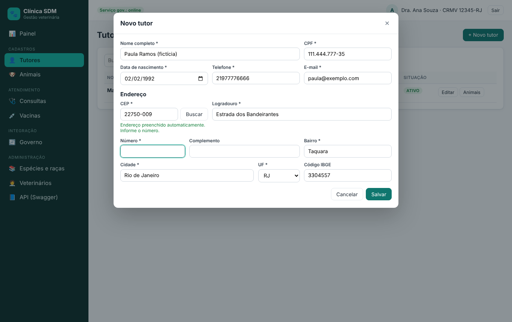
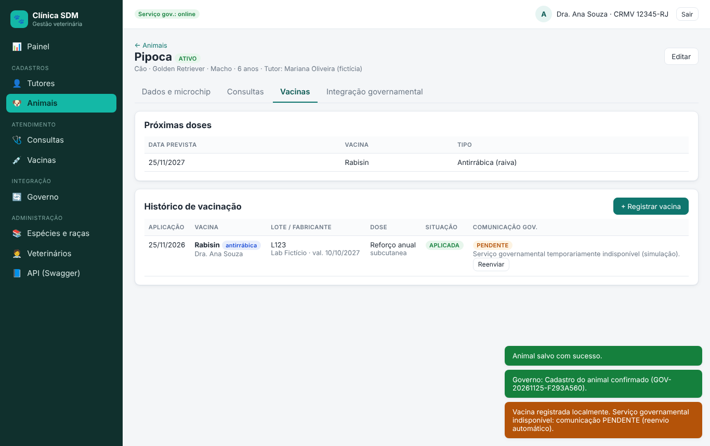
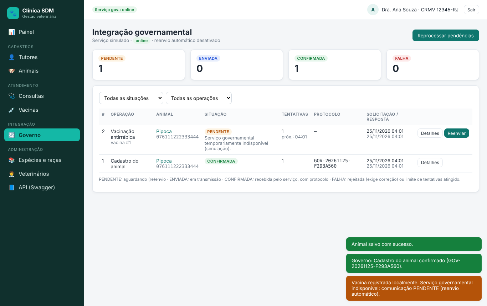
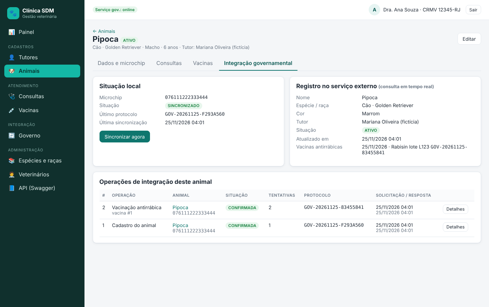

# SDM — Sistema de Gestão de Clínica Veterinária

Projeto Integrador A3 · **Sistemas Distribuídos e Mobile** · entrega em 26/11/2026

Sistema web para gestão de clínica veterinária com **API privada**, consumo da **API pública ViaCEP** e integração com uma **API governamental simulada**. O foco é a **comunicação obrigatória de vacinas antirrábicas**, com tratamento de indisponibilidade, pendências, reenvio e **idempotência** (sem duplicidade).

> A API governamental é fictícia, feita para fins acadêmicos. Todos os dados são fictícios.

---

## ▶Como executar

### Pré-requisitos
- **Python 3.10 ou superior** (com `pip`). Nada mais: os bancos são SQLite e são criados automaticamente.

### Jeito rápido
- **Windows:** dê dois cliques em `iniciar.bat`
- **Linux/macOS:** `./iniciar.sh`

Os scripts instalam as dependências (`Flask` e `requests`), sobem os dois serviços e abrem o navegador.

### Passo a passo manual
```bash
pip install -r requirements.txt

# terminal 1 — API governamental simulada (porta 5001)
cd api_governo
python app.py

# terminal 2 — API da clínica + frontend (porta 5000)
cd api_clinica
python app.py
```

| Endereço | O que é |
|---|---|
| <http://127.0.0.1:5000> | **Sistema da clínica** (frontend) |
| <http://127.0.0.1:5000/docs> | Swagger da API da clínica |
| <http://127.0.0.1:5001> | Painel do serviço governamental simulado (liga/desliga a indisponibilidade) |
| <http://127.0.0.1:5001/docs> | Swagger da API governamental |

### Usuários de demonstração (senha `Senha@123`)
| E-mail | Situação | Resultado no login |
|---|---|---|
| `ana@clinica.vet` | ativa, senha confirmada | entra |
| `bruno@clinica.vet` | inativo | bloqueado |
| `carla@clinica.vet` | senha não confirmada | bloqueado (vai para a confirmação) |

### Recriar os bancos (dados iniciais)
```bash
python resetar_bancos.py      # com os serviços parados
```

---

## Testes

Com os dois serviços rodando (de preferência com `RETRY_AUTO=0` na clínica, para a pendência não ser resolvida sozinha durante o teste 14):

```bash
python tests/testes_obrigatorios.py
```
O script executa os **16 testes obrigatórios + 7 complementares** e gera `docs/04_relatorio_testes.md`.

**Postman:** importe `tests/SDM_Clinica.postman_collection.json` e rode com o *Collection Runner* (as pastas 01 a 16 seguem a ordem dos testes do enunciado).

**Sem internet?** Rode `python tests/mock_viacep.py` e inicie a clínica com
`VIACEP_URL=http://127.0.0.1:5099/ws/{cep}/json/` (no Windows: `set VIACEP_URL=...`). O dublê responde no mesmo formato do ViaCEP.

---

## Estrutura

```
sdm-clinica-vet/
├── api_clinica/                 # SERVIÇO 1 — API privada + frontend (porta 5000)
│   ├── app.py                   # criação da aplicação, erros, docs, frontend
│   ├── config.py                # configurações (variáveis de ambiente)
│   ├── database.py              # conexão SQLite, criação e carga inicial
│   ├── db/schema.sql            # script de criação do banco da clínica
│   ├── core/                    # segurança (token/sessão) e validações
│   ├── clients/                 # clientes HTTP: ViaCEP e API governamental
│   ├── services/integracao.py   # outbox, envio, reenvio, worker, idempotência
│   ├── routes/                  # controladores REST (auth, cadastros, animais, atendimento)
│   ├── static/                  # frontend: index.html, style.css, app.js
│   └── openapi.yaml
├── api_governo/                 # SERVIÇO 2 — API governamental simulada (porta 5001)
│   ├── app.py
│   ├── schema.sql               # script de criação do banco do governo
│   ├── static/painel.html       # painel de simulação de falhas
│   └── openapi.yaml
├── tests/
│   ├── testes_obrigatorios.py   # 16 testes do enunciado + complementares
│   ├── SDM_Clinica.postman_collection.json
│   ├── mock_viacep.py           # dublê do ViaCEP para ambientes sem internet
│   └── resultado_testes.json
├── docs/
│   ├── 01_requisitos_arquitetura.md
│   ├── 02_modelo_dados.md       # DER + modelo relacional
│   ├── 03_endpoints.md
│   ├── 04_relatorio_testes.md
│   └── diagramas/               # DER, arquitetura e sequência (PNG + Mermaid)
├── iniciar.bat / iniciar.sh
├── resetar_bancos.py
└── requirements.txt
```

## Entregáveis do enunciado

| # | Entregável | Onde |
|---|---|---|
| 1 | Documento de requisitos e arquitetura | `docs/01_requisitos_arquitetura.md` |
| 2 | DER e modelo relacional | `docs/02_modelo_dados.md`, `docs/diagramas/der.png` |
| 3 | Código-fonte do frontend | `api_clinica/static/` |
| 4 | Código-fonte da API privada | `api_clinica/` |
| 5 | Código-fonte da API governamental simulada | `api_governo/` |
| 6 | Script de criação e inicialização dos bancos | `api_clinica/db/schema.sql`, `api_governo/schema.sql`, `resetar_bancos.py` |
| 7 | Documentação dos endpoints | `docs/03_endpoints.md`, `openapi.yaml` (Swagger em `/docs`) |
| 8 | Coleção de testes das APIs | `tests/SDM_Clinica.postman_collection.json`, `tests/testes_obrigatorios.py` |
| 9 | Relatório dos testes | `docs/04_relatorio_testes.md` |
| 10 | Instruções de instalação e execução | este README |

## Configurações (variáveis de ambiente)

| Variável | Padrão | Função |
|---|---|---|
| `CLINICA_PORT` / `GOV_PORT` | 5000 / 5001 | portas |
| `GOV_API_URL` | `http://127.0.0.1:5001` | endereço do serviço governamental |
| `VIACEP_URL` | `https://viacep.com.br/ws/{cep}/json/` | endereço do ViaCEP |
| `RETRY_AUTO` | `1` | liga o worker de reenvio automático |
| `RETRY_INTERVALO_SEG` | `30` | intervalo base do worker (com backoff exponencial) |
| `RETRY_MAX_TENTATIVAS` | `10` | tentativas automáticas antes de virar FALHA |
| `GOV_TIMEOUT_CONEXAO` / `GOV_TIMEOUT_LEITURA` | 3 / 5 s | timeouts da integração |
| `DEV_MODE` | `1` | mostra o código de confirmação na tela (e-mail simulado) |
| `CLINICA_SECRET` | (valor de dev) | chave de assinatura dos tokens; troque em produção |

## Telas

| | |
|---|---|
|  |  |
| Tutor com CEP preenchido pelo ViaCEP<br> | Antirrábica registrada com o governo fora do ar → PENDENTE<br> |
| Controle das integrações<br> | Situação governamental do animal (tempo real)<br> |
