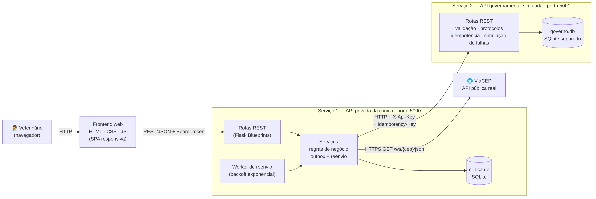
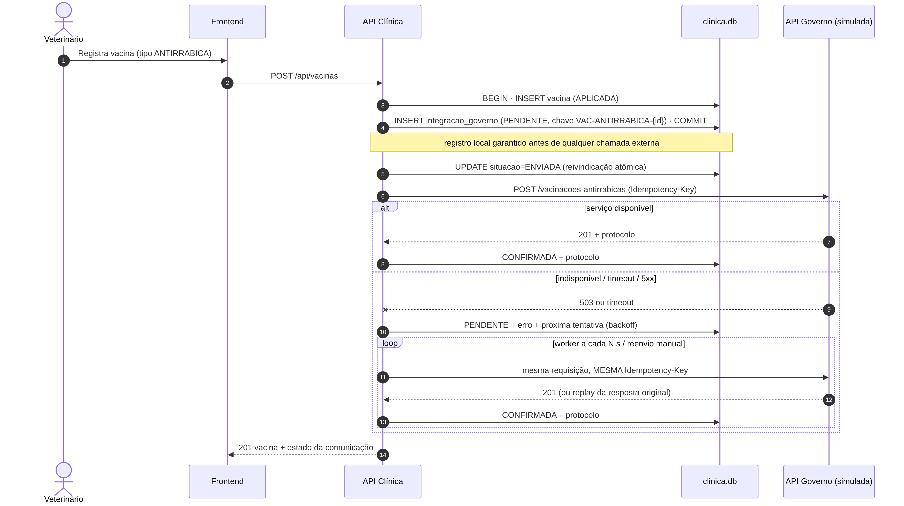

# 1. Documento de Requisitos e Arquitetura

**Projeto:** SDM — Sistema Web para Gestão de Clínica Veterinária com Integração de APIs
**Disciplina:** A3 — Projeto Integrador · Sistemas Distribuídos e Mobile
**Entrega:** 26/11/2026

---

## 1.1 Visão geral

Sistema web para uma clínica veterinária gerenciar tutores, animais, veterinários, consultas e vacinas. Ele é formado por **três partes independentes que conversam por HTTP**:

| Componente | Responsabilidade | Porta | Persistência |
|---|---|---|---|
| **Frontend web** | Interface responsiva usada pelos veterinários (SPA em HTML/CSS/JS) | servida pela API da clínica (5000) | navegador (só o token de sessão) |
| **API privada da clínica** | Regras de negócio, validações, autenticação, persistência, consumo do ViaCEP e integração com o governo | 5000 | `clinica.db` |
| **API governamental simulada** | Simula um serviço de registro de animais com microchip e de vacinação antirrábica | 5001 | `governo.db` (banco separado) |
| **ViaCEP** (externa, real) | Consulta pública de CEP | — | — |

> A API governamental é **fictícia**, feita só para fins acadêmicos. Ela não representa integração oficial com nenhum sistema governamental real.

## 1.2 Requisitos funcionais

| ID | Requisito | Onde está implementado |
|---|---|---|
| RF01 | Login por e-mail e senha | `POST /api/auth/login` · tela de login |
| RF02 | Cadastro de veterinário com senha armazenada como *hash* (PBKDF2/scrypt via Werkzeug) | `POST /api/auth/registro` |
| RF03 | Confirmação da senha por código de 6 dígitos enviado por e-mail (**envio simulado**: aparece no console, na tabela `email_simulado` e, em modo dev, na tela) | `POST /api/auth/confirmar-senha`, `/reenviar-codigo` |
| RF04 | Bloqueio de veterinário inativo e de veterinário sem senha confirmada, reavaliado **a cada requisição** | `core/seguranca.py` |
| RF05 | Logout com encerramento da sessão no servidor (token revogado) | `POST /api/auth/logout` |
| RF06 | Proteção de todos os endpoints privados (401 sem token) | decorator `@login_obrigatorio` |
| RF07 | CRUD de tutores com CPF validado (dígitos verificadores) e único; inativação lógica | `/api/tutores` |
| RF08 | Cadastro de endereços com preenchimento automático pelo ViaCEP, complementação manual e tratamento de CEP inexistente, formato inválido, timeout e indisponibilidade | `/api/cep/{cep}`, `/api/enderecos` |
| RF09 | Catálogo de espécies e de raças vinculadas à espécie, com a opção "sem raça definida" | `/api/especies`, `/api/racas` |
| RF10 | Garantia de raça compatível com a espécie (validação na API **e** FK composta no banco) | `routes/animais.py`, `schema.sql` |
| RF11 | Manutenção de veterinários (dados, ativação/inativação com encerramento das sessões) | `/api/veterinarios` |
| RF12 | Cadastro e atualização de animais com tutor obrigatório | `/api/animais` |
| RF13 | Vínculo de microchip RFID (15 dígitos, ISO 11784/11785) por veterinário autenticado, registrando profissional e data | `POST /api/animais/{id}/microchip` |
| RF14 | Microchip único: um código **nunca** pode ser reutilizado, nem depois de substituído | `UNIQUE` em `vinculo_microchip.codigo_microchip` |
| RF15 | Substituição de microchip com motivo, preservando o histórico | tabela `vinculo_microchip` |
| RF16 | Registro e histórico de consultas (anamnese, sintomas, diagnóstico, tratamento, prescrição, peso, temperatura, situação) | `/api/consultas`, `/api/animais/{id}/consultas` |
| RF17 | Registro de vacinas com **classificação estruturada** (`tipo_vacina`); o indicador antirrábico é derivado do tipo, nunca do texto digitado | `/api/vacinas`, `CHECK` no banco |
| RF18 | Histórico de vacinação e próximas doses (por animal e da clínica toda) | `/api/animais/{id}/vacinas`, `/api/vacinas/proximas-doses` |
| RF19 | **Comunicação obrigatória** de toda vacina antirrábica aplicada, feita depois do registro local | `services/integracao.py` |
| RF20 | Comunicação independente de cadastro prévio do animal no serviço externo (cadastro implícito) | `POST /api/governo/vacinacoes-antirrabicas` |
| RF21 | Registro do resultado e do protocolo da comunicação; distinção entre "registrada localmente" e "confirmada pelo governo" | campo `comunicacao_governo` da vacina |
| RF22 | Pendência quando o serviço está indisponível, com reenvio **automático** (worker com backoff) e **manual** | `WorkerReenvio`, `/api/integracoes/{id}/reenviar` |
| RF23 | Reenvio sem duplicidade no serviço externo (chave de idempotência + unicidade natural) | `Idempotency-Key` |
| RF24 | Cadastro, consulta e atualização do animal na API governamental | `/api/governo/animais` |
| RF25 | Consulta da situação de integração governamental do animal (local e em tempo real) | `/api/animais/{id}/situacao-governo` |
| RF26 | API governamental: validação, prevenção de duplicidade, protocolos, consulta de operação, simulação de erros e de indisponibilidade | `api_governo/app.py` |

## 1.3 Regras de negócio

1. Só veterinários **cadastrados, ativos e com senha confirmada** acessam o sistema.
2. A senha nunca é guardada em texto puro. O código de confirmação também é guardado como *hash* e expira em 30 minutos.
3. O CPF de tutores e veterinários é validado e não pode se repetir. O CRMV é único por UF.
4. Todo animal tem um tutor ativo. A raça, quando informada, pertence à espécie do animal.
5. O microchip tem 15 dígitos, é único e é vinculado pelo veterinário autenticado. Cada animal tem no máximo um vínculo ativo (índice único parcial).
6. A substituição do microchip exige motivo e mantém o vínculo anterior como inativo, apontando para o novo.
7. Consulta e vacina sempre ficam associadas a um animal e a um veterinário (o usuário autenticado).
8. Vacina **aplicada** é imutável (só observações e próxima dose podem mudar) e não pode ser cancelada, para garantir a rastreabilidade.
9. Validade do lote ≥ data de aplicação; próxima dose > data de aplicação; vacina aplicada não pode ter data futura.
10. **Antirrábica aplicada ⇒ comunicação obrigatória.** A solicitação é gravada **na mesma transação** da vacina (padrão *Transactional Outbox*), então a vacina nunca é registrada sem a respectiva solicitação.
11. Vacinas não antirrábicas não geram comunicação.
12. Falha de comunicação nunca desfaz o registro local.
13. Reenvios usam sempre a **mesma chave de idempotência** (`VAC-ANTIRRABICA-{id da vacina}`).
14. Exclusões são lógicas (situação `INATIVO` / `CANCELADA`).

## 1.4 Requisitos não funcionais

| RNF | Como foi atendido |
|---|---|
| Interface responsiva | CSS próprio com *grid* e *media queries* (menu lateral recolhível em telas < 820 px) |
| Comunicação frontend↔backend por REST | `fetch` + JSON. O frontend não acessa o banco |
| Banco relacional | SQLite 3 com PK, FK, UNIQUE, CHECK e índices. O script SQL é portável para PostgreSQL |
| Validação no frontend e no backend | atributos HTML5 (`required`, `type`, `min/max`) + classe `Validador` na API, que é a fonte da verdade |
| Tratamento de erros HTTP, timeout e indisponibilidade | timeouts configuráveis (ViaCEP 5 s; governo 3 s de conexão / 5 s de leitura), mensagens padronizadas `{erro, status, detalhes}` |
| Autenticação e autorização | token assinado (itsdangerous) + tabela de sessões revogáveis; checagem de situação/confirmação a cada requisição; `X-Api-Key` entre serviços |
| Armazenamento seguro de credenciais | *hash* com sal (Werkzeug). Nenhum endpoint retorna o hash |
| Registro das operações de integração | tabela `integracao_governo` (payload, resposta, HTTP, tentativas, datas) + tabela `operacao` no governo |
| Documentação dos endpoints | OpenAPI 3 (`/docs` em cada serviço) + `docs/03_endpoints.md` |
| Código em camadas | `routes/` (controladores), `services/` (regras de integração), `clients/` (HTTP externo), `core/` (segurança e validação), `database.py` (dados) |
| Dados fictícios | carga inicial com nomes marcados "(fictício)" e CPFs gerados pelo algoritmo |

## 1.5 Tecnologias e justificativas

| Camada | Escolha | Justificativa |
|---|---|---|
| Backend (os dois serviços) | **Python 3 + Flask** | Leve, didático e com só duas dependências (`Flask`, `requests`). Os Blueprints organizam as rotas em camadas |
| Banco | **SQLite 3** (um arquivo por serviço) | Relacional completo (FK, CHECK, índices parciais, transações), sem instalar servidor. Isso facilita a correção e a demonstração. Cada serviço tem o seu arquivo, o que deixa clara a separação exigida |
| Frontend | **HTML5 + CSS3 + JavaScript puro** | Sem etapa de build. Mostra o consumo REST de forma explícita |
| Segurança | Werkzeug (hash), itsdangerous (token assinado) | Já vêm com o Flask |
| Documentação | OpenAPI 3 / Swagger UI | Padrão de mercado, sugerido no enunciado |
| Testes | Script Python automatizado + coleção Postman | Reproduzem os 16 testes obrigatórios e geram evidências |
| Versionamento | Git | `.gitignore` incluso |

## 1.6 Decisões de arquitetura — sistemas distribuídos

**a) Separação de serviços.** A clínica e o "governo" rodam em **processos, portas e bancos diferentes** e só conversam por HTTP. Dá para derrubar um sem afetar o outro.

**b) Transactional Outbox.** Ao registrar a vacina antirrábica, a API grava a vacina **e** a linha de `integracao_governo` (PENDENTE) numa única transação. Só depois do *commit* ela tenta o envio. Isso evita dois problemas clássicos:
- "registrei a vacina mas perdi a comunicação" (queda entre as duas operações);
- "comuniquei ao governo uma vacina que não foi gravada".

**c) Idempotência.** Toda escrita no governo leva o cabeçalho `Idempotency-Key`. Se a chave já foi processada, o serviço devolve a **mesma resposta e o mesmo protocolo** (`Idempotent-Replay: true`) sem gravar de novo. Há também uma segunda barreira: `UNIQUE(origem_sistema, id_aplicacao_origem)` na tabela de vacinações.

**d) Timeout com processamento tardio.** No modo `LENTO`, o governo processa a requisição *depois* que a clínica já desistiu por timeout. A clínica marca PENDENTE e reenvia, e o governo reconhece a chave. Resultado: **um único registro** (teste complementar C7). É exatamente o cenário em que a idempotência é indispensável.

**e) Concorrência no reenvio.** Antes de enviar, a linha passa de `PENDENTE/FALHA` para `ENVIADA` com um `UPDATE ... WHERE situacao IN (...)` atômico. Se o worker automático e um reenvio manual coincidirem, só um deles "ganha" a linha. Uma linha presa em `ENVIADA` por mais de 60 s (processo caiu no meio do envio) volta a ser elegível.

**f) Política de reenvio.** O worker roda a cada `RETRY_INTERVALO_SEG` (padrão 30 s) com *backoff* exponencial (30 s, 60 s, 120 s… até 10 min) e até 10 tentativas automáticas. Depois disso a operação vai para FALHA e ainda pode ser reenviada manualmente.

**g) Classificação de erros.**

| Resposta do governo | Situação local | Reenvio automático? |
|---|---|---|
| 2xx | CONFIRMADA (guarda o protocolo) | — |
| Timeout, conexão recusada, 5xx, 408, 429 | PENDENTE | Sim |
| 4xx de validação (422, 404, 409) | FALHA | Não (precisa de correção + reenvio manual) |
| Animal sem microchip | FALHA "aguardando microchip" | Volta à fila automaticamente quando o chip é vinculado |

**h) Situações da integração:** `PENDENTE` (aguardando envio) → `ENVIADA` (em transmissão) → `CONFIRMADA` (protocolo recebido) ou `FALHA`.

## 1.7 Premissas adotadas

- **Envio de e-mail simulado** (permitido pelo enunciado). Com `DEV_MODE=1` (padrão), o código aparece na resposta da API e na tela, para agilizar a demonstração.
- **Leitura física do microchip simulada**: o código é digitado ou gerado na tela.
- **Qualquer veterinário ativo é "autorizado"** a vincular microchip e a gerenciar cadastros (não há perfis distintos, pois o enunciado não exige).
- **ViaCEP sem internet:** a URL é configurável (`VIACEP_URL`). Para executar os testes sem rede existe um dublê local (`tests/mock_viacep.py`) que responde no formato do ViaCEP. Com internet, a API real é usada por padrão.
- **Cadastro implícito:** se a vacina antirrábica chegar ao governo antes do cadastro do animal, o governo cria o registro a partir do bloco `animal` do payload (`cadastro_implicito = true`). Isso atende à regra de que a comunicação independe de cadastro prévio.

## 1.8 Cronograma executado

| Semana | Milestone | Entregáveis no projeto |
|---|---|---|
| 1 — 29/10 | Modelagem e arquitetura | este documento, `02_modelo_dados.md`, diagramas, estrutura do repositório |
| 2 — 05/11 | Banco e API privada | `schema.sql`, `database.py`, CRUDs, autenticação, coleção Postman |
| 3 — 12/11 | Interface web e funcionalidades clínicas | frontend (`static/`), ViaCEP, microchip, consultas, vacinas |
| 4 — 19/11 | API governamental e integração distribuída | `api_governo/`, `services/integracao.py`, idempotência, reenvio |
| 5 — 26/11 | Testes, documentação e apresentação | `04_relatorio_testes.md`, OpenAPI, README |
