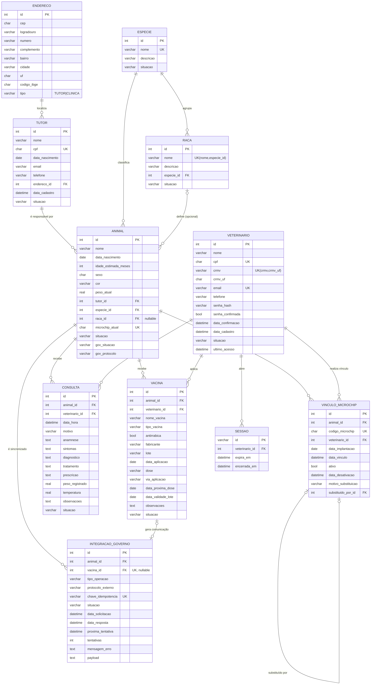

# 2. Modelo de Dados

São dois bancos **fisicamente separados**:

- `api_clinica/data/clinica.db` — banco da clínica (script: `api_clinica/db/schema.sql`)
- `api_governo/data/governo.db` — banco do serviço governamental simulado (script: `api_governo/schema.sql`)

Os bancos são criados automaticamente na primeira execução. Para recriá-los com os dados fictícios iniciais: `python resetar_bancos.py`.

## 2.1 Diagrama Entidade-Relacionamento (clínica)

*Fonte editável: `docs/diagramas/der.mmd` (Mermaid).*

As 10 entidades obrigatórias estão presentes: **Tutor, Animal, Espécie, Raça, Endereço, Veterinário, Consulta, Vacina, VínculoMicrochip e IntegraçãoGoverno**. As tabelas de apoio são `sessao` (logout/revogação de token) e `email_simulado` (caixa de saída do e-mail simulado).

## 2.2 Modelo relacional

Notação: **sublinhado = PK**, *itálico = FK*, UK = restrição de unicidade.

| Tabela | Atributos |
|---|---|
| **endereco** | <u>id</u>, cep, logradouro, numero, complemento, bairro, cidade, uf, codigo_ibge, tipo |
| **tutor** | <u>id</u>, nome, cpf (UK), data_nascimento, email, telefone, *endereco_id* → endereco, data_cadastro, situacao |
| **especie** | <u>id</u>, nome (UK), descricao, situacao |
| **raca** | <u>id</u>, nome, descricao, *especie_id* → especie, situacao · UK(nome, especie_id) · UK(id, especie_id) |
| **veterinario** | <u>id</u>, nome, cpf (UK), crmv, crmv_uf, email (UK), telefone, senha_hash, senha_confirmada, data_confirmacao, codigo_confirmacao_hash, codigo_expira_em, data_cadastro, situacao, ultimo_acesso · UK(crmv, crmv_uf) |
| **sessao** | <u>id</u>, *veterinario_id* → veterinario, criada_em, expira_em, encerrada_em |
| **animal** | <u>id</u>, nome, data_nascimento, idade_estimada_meses, sexo, cor, peso_atual, *tutor_id* → tutor, *especie_id* → especie, *raca_id*, microchip_atual (UK), situacao, gov_situacao, gov_protocolo, gov_ultima_sync, data_cadastro · FK(*raca_id*, *especie_id*) → raca(id, especie_id) |
| **vinculo_microchip** | <u>id</u>, *animal_id* → animal, codigo_microchip (UK), *veterinario_id* → veterinario, data_implantacao, data_vinculo, ativo, data_desativacao, motivo_substituicao, *substituido_por_id* → vinculo_microchip · UK parcial(animal_id) WHERE ativo = 1 |
| **consulta** | <u>id</u>, *animal_id* → animal, *veterinario_id* → veterinario, data_hora, motivo, anamnese, sintomas, diagnostico, tratamento, prescricao, peso_registrado, temperatura, observacoes, situacao, criada_em |
| **vacina** | <u>id</u>, *animal_id* → animal, *veterinario_id* → veterinario, nome_vacina, tipo_vacina, antirrabica, fabricante, lote, data_aplicacao, dose, via_aplicacao, data_proxima_dose, data_validade_lote, observacoes, situacao, criada_em |
| **integracao_governo** | <u>id</u>, *animal_id* → animal, *vacina_id* → vacina (UK parcial), tipo_operacao, protocolo_externo, chave_idempotencia (UK), situacao, data_solicitacao, data_ultimo_envio, data_resposta, proxima_tentativa, tentativas, http_status, mensagem_erro, payload, resposta |
| **email_simulado** | <u>id</u>, destinatario, assunto, corpo, enviado_em |

## 2.3 Relacionamentos e cardinalidades

| Relacionamento | Cardinalidade | Observação |
|---|---|---|
| Endereço — Tutor | 1 : N | todo tutor tem um endereço |
| Tutor — Animal | 1 : N | todo animal tem exatamente um tutor (FK NOT NULL) |
| Espécie — Raça | 1 : N | toda raça pertence a uma espécie |
| Espécie — Animal | 1 : N | |
| Raça — Animal | 0..1 : N | `raca_id` nulo = sem raça definida |
| Animal — VínculoMicrochip | 1 : N | histórico; no máximo 1 ativo por animal |
| Veterinário — VínculoMicrochip | 1 : N | quem fez o vínculo |
| VínculoMicrochip — VínculoMicrochip | 0..1 : 0..1 | `substituido_por_id` encadeia as substituições |
| Animal — Consulta / Veterinário — Consulta | 1 : N | |
| Animal — Vacina / Veterinário — Vacina | 1 : N | |
| Animal — IntegraçãoGoverno | 1 : N | cadastro, atualizações e vacinações |
| Vacina — IntegraçãoGoverno | 0..1 : 0..1 | só antirrábica aplicada; **uma** comunicação por aplicação |
| Veterinário — Sessão | 1 : N | |

## 2.4 Restrições de integridade relevantes

| Restrição | Objetivo |
|---|---|
| `tutor.cpf UNIQUE`, `veterinario.cpf UNIQUE` | CPF não duplicado |
| `veterinario.email UNIQUE`, `UNIQUE(crmv, crmv_uf)` | identificação única do profissional |
| `vinculo_microchip.codigo_microchip UNIQUE` | um microchip nunca é reutilizado, nem após a substituição |
| `animal.microchip_atual UNIQUE` | acesso rápido ao chip ativo, sem repetição |
| índice único parcial `vinculo_microchip(animal_id) WHERE ativo = 1` | no máximo um chip ativo por animal |
| FK composta `animal(raca_id, especie_id) → raca(id, especie_id)` | o banco impede raça de outra espécie |
| `CHECK (data_nascimento IS NOT NULL OR idade_estimada_meses IS NOT NULL)` | data de nascimento **ou** idade estimada |
| `CHECK (antirrabica = CASE WHEN tipo_vacina='ANTIRRABICA' THEN 1 ELSE 0 END)` | indicador antirrábico sempre coerente com a classificação estruturada |
| `CHECK (data_proxima_dose > data_aplicacao)` | coerência das datas |
| `integracao_governo.chave_idempotencia UNIQUE` | uma solicitação lógica = uma linha |
| índice único parcial `integracao_governo(vacina_id)` | uma comunicação por aplicação de vacina |
| `CHECK (tipo_operacao <> 'VACINACAO_ANTIRRABICA' OR vacina_id IS NOT NULL)` | comunicação de vacina sempre aponta para a vacina |
| `CHECK` de domínio em todas as colunas `situacao`, `sexo`, `via_aplicacao` etc. | valores válidos |

## 2.5 Banco do serviço governamental (separado)

| Tabela | Atributos principais |
|---|---|
| **animal_registro** | <u>id</u>, microchip (UK), nome, especie, raca, sexo, data_nascimento, cor, tutor_nome, tutor_cpf, tutor_municipio_ibge, veterinario_crmv, veterinario_crmv_uf, origem_sistema, id_animal_origem, microchip_anterior, situacao (ATIVO/SUBSTITUIDO), cadastro_implicito |
| **vacinacao_antirrabica** | <u>id</u>, *animal_registro_id*, microchip, origem_sistema, id_aplicacao_origem, data_aplicacao, vacina_nome, fabricante, lote, veterinario_*, protocolo · **UK(origem_sistema, id_aplicacao_origem)** |
| **operacao** | <u>protocolo</u>, tipo, chave_idempotencia (UK), microchip, status (PROCESSADA/REJEITADA), http_status, mensagem, payload, resposta, recebida_em, replays |
| **simulacao** | <u>id</u>=1, modo (NORMAL/INDISPONIVEL/LENTO/ERRO_INTERMITENTE), atraso_segundos |

## 2.6 Dados fictícios iniciais

| Tipo | Registros |
|---|---|
| Espécies | Cão, Gato, Ave |
| Raças | 13 (incluindo SRD por espécie) |
| Veterinários (senha `Senha@123`) | Dra. Ana Souza — **ativa e confirmada** · Dr. Bruno Lima — **inativo** · Dra. Carla Mendes — **senha não confirmada** |
| Tutor | Mariana Oliveira (fictícia), com endereço na Taquara/RJ |
| Animais | Thor (cão, Labrador) e Mia (gata, sem raça definida), ainda sem microchip |
| Endereço da clínica | Barra da Tijuca/RJ (fictício) |
